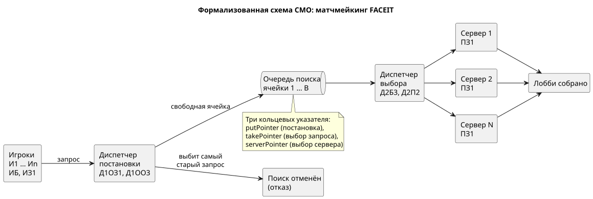
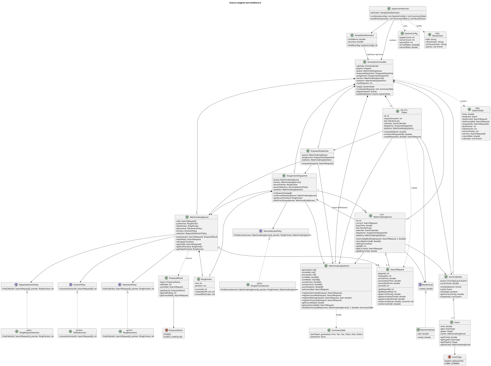
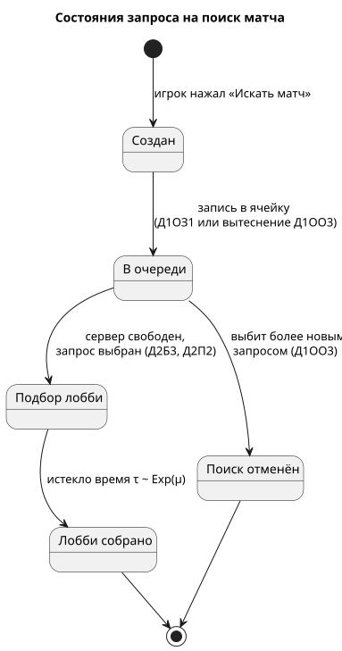
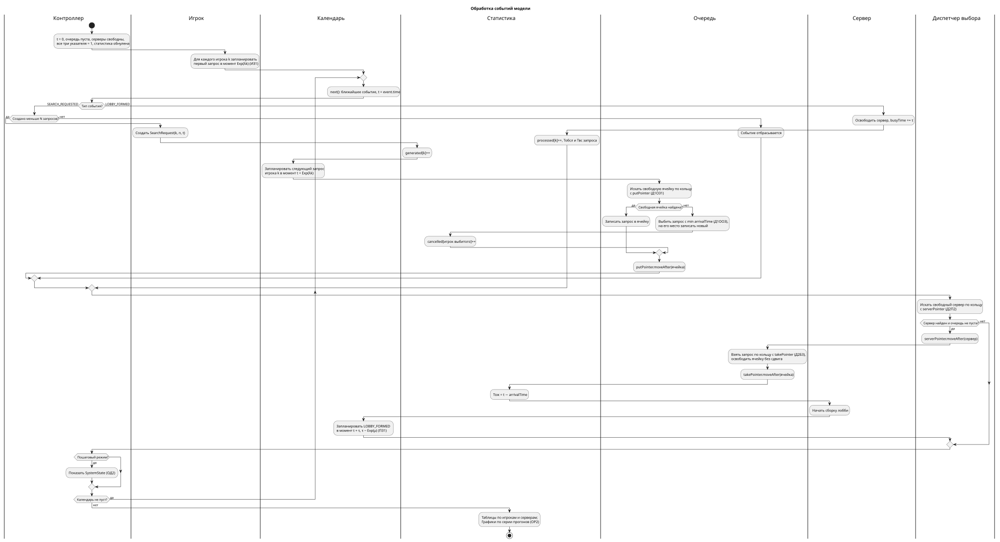
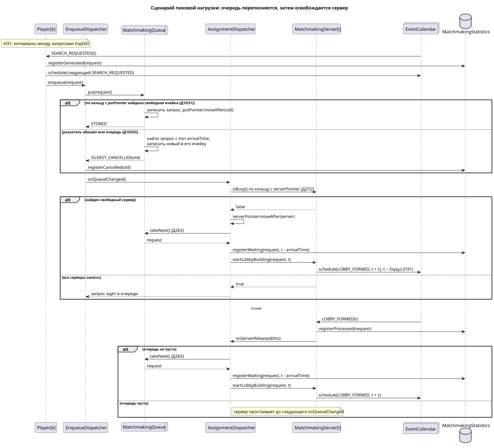

# FACEIT Matchmaking: имитационная модель СМО (вариант 29)

Модель очереди поиска матча на платформе FACEIT. Игроки отправляют запросы «Искать матч», серверы подбора собирают для них лобби. Пока все серверы заняты, запросы ждут в ограниченной очереди. Если очередь переполнена, отменяется поиск у того, кто ждёт дольше всех.

Формула варианта: `ИБ | ИЗ1 | ПЗ1 | Д1ОЗ1 | Д1ОО3 | Д2П2 | Д2Б3 | ОР2 | ОД2`

## Формула и домен

| Код | Правило СМО | В матчмейкинге |
|---|---|---|
| ИБ | Бесконечный источник | Игроки заходят в поиск, пока работает платформа |
| ИЗ1 | Пуассоновский поток | Интервалы между запросами распределены экспоненциально |
| ПЗ1 | Экспоненциальное обслуживание | Время сборки лобби случайно |
| Д1ОЗ1 | Постановка в буфер по кольцу | Свободная ячейка очереди ищется с указателя постановки |
| Д1ОО3 | Отказ самой старой заявке | Выбивается запрос с самым ранним временем поступления |
| Д2П2 | Выбор прибора по кольцу | Свободный сервер подбора ищется с указателя серверов |
| Д2Б3 | Выбор заявки по кольцу | Занятая ячейка очереди ищется с указателя выбора |
| ОР2 | Графики | Зависимость характеристик от параметров системы |
| ОД2 | Формализованная схема | Состояние очереди, указателей и серверов на каждом шаге |

Заявка здесь это запрос на поиск матча: номер игрока, номер запроса, время поступления. Приборы это серверы подбора. Число игроков, серверов и размер очереди задаются параметрами модели.

## Устройство модели

Модель дискретно-событийная. В календаре два вида событий: `SEARCH_REQUESTED` (игрок отправил запрос) и `LOBBY_FORMED` (сервер закончил сборку лобби). После каждого события диспетчер выбора пробует назначить запрос на свободный сервер.

Указателей три: постановки, выбора запроса и выбора сервера. Каждая дисциплина вынесена в отдельную стратегию.

| Код | Интерфейс | Реализация |
|---|---|---|
| Д1ОЗ1 | `PlacementPolicy` | `RingPlacement` |
| Д1ОО3 | `EvictionPolicy` | `OldestEviction` |
| Д2Б3 | `RequestSelectionPolicy` | `RingRequestSelection` |
| Д2П2 | `ServerSelectionPolicy` | `RingServerSelection` |

## Диаграммы

Формализованная схема:



Классы:



Состояния запроса:



Обработка событий:



Сценарий пиковой нагрузки:



## Структура репозитория

```
artifacts/  --> исходники диаграмм (.puml)
artifacts/imgs/ --> картинки (.svg)
```
